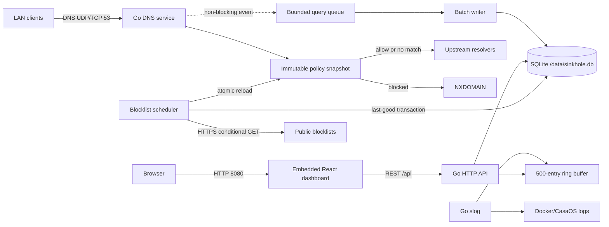
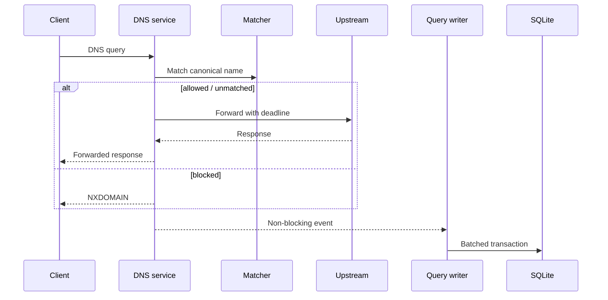

# Architecture

## Goals

Network-Wide DNS Sinkhole is a self-hosted DNS filtering service for a trusted home LAN. It prioritizes a small operational footprint, accurate query history, deterministic rule precedence, and safe last-known-good blocklist updates over broad Pi-hole feature parity.

## System context

The production artifact is one static Go binary with the compiled React frontend embedded. Docker adds CA certificates and a non-root runtime.

## Runtime components

| Package | Responsibility |
|---|---|
| `internal/dnsserver` | UDP/TCP serving, deadlines, bounded upstream concurrency, failover, truncation |
| `internal/rules` | Domain normalization, immutable matcher, atomic policy manager |
| `internal/blocklists` | HTTPS fetch, conditional requests, parser, refresh scheduling, last-good activation |
| `internal/querylog` | Query event model, bounded asynchronous queue, batched writer |
| `internal/store` | SQLite migrations, rule/blocklist/query repositories, statistics |
| `internal/api` | JSON API, validation, cursor pagination, error mapping |
| `internal/oplog` | Bounded in-memory operational log mirror |
| `internal/webui` | Embedded static dashboard and security headers |
| `web` | React, TypeScript, Tailwind, DaisyUI dashboard |

## DNS request flow

1. A UDP or TCP listener accepts a query.
2. The handler canonicalizes the name and checks one immutable matcher snapshot.
3. Precedence is allow rule → manual deny rule → enabled blocklist domain.
4. A block returns `NXDOMAIN` immediately and records the blocked event.
5. Other queries are forwarded with a request deadline. Configured upstreams are tried round-robin with fallback.
6. The response is relayed, truncated for UDP when required, and recorded.
7. Query persistence is asynchronous; DNS never waits for SQLite or the dashboard.

## Policy updates

Rules and blocklists never mutate the matcher in place. A reload reads all active rules plus enabled blocklist memberships, builds a new immutable map/suffix snapshot, and atomically swaps a pointer. Readers therefore see either the old complete policy or the new complete policy.

A successful blocklist refresh:

1. Downloads with ETag/Last-Modified validators.
2. Parses into a deduplicated domain set.
3. Replaces the source's domain rows in one SQLite transaction.
4. Rebuilds and swaps the matcher.

A failed fetch or parse records the error and leaves both the previous rows and matcher active.

## Persistence and concurrency

SQLite runs in WAL mode with foreign keys and a busy timeout. The store intentionally uses one connection because connection-scoped PRAGMAs are configured at open; this also serializes writer/reader access without lock errors. The query queue absorbs DNS bursts, and writes occur in bounded batches.

Dashboard data comes from the persisted query rows:

- Newest-first ID keyset pagination
- Optional client, domain, outcome, and timestamp filters
- Totals, unique clients, top blocked domains, top clients, and time buckets
- Configurable retention with bounded cleanup

## Security model

- The service is intended for a trusted LAN and is not an open public resolver.
- Admin endpoints have no authentication in this version; do not expose them to the internet.
- DNS blocked responses are authoritative only for policy blocks; upstream failures return `SERVFAIL`.
- Blocklist URLs require HTTPS, reject credentials, have redirect restrictions, and enforce timeout/size limits.
- Downloaded content is parsed as data only. Unsupported cosmetic and complicated filter rules are ignored.
- The container runs non-root with only `NET_BIND_SERVICE`.
- HTTP mutations require JSON content types and bounded request bodies.
- The dashboard sends CSP, frame denial, referrer, permissions, and MIME-sniffing protections.

## Known trade-offs

- DNS filtering cannot block same-domain ads or URL-path-specific ads.
- Docker bridge networking can obscure client addresses on some hosts; verify two clients and use host networking if necessary.
- One SQLite connection favors simplicity over multi-writer throughput.
- Query persistence is delayed by at most roughly one flush interval.
- Blocklist URLs are fetched blindly after HTTPS validation; a homelab administrator is trusted to choose sources.
- Prometheus metrics and authentication are optional future work, not core dependencies.
